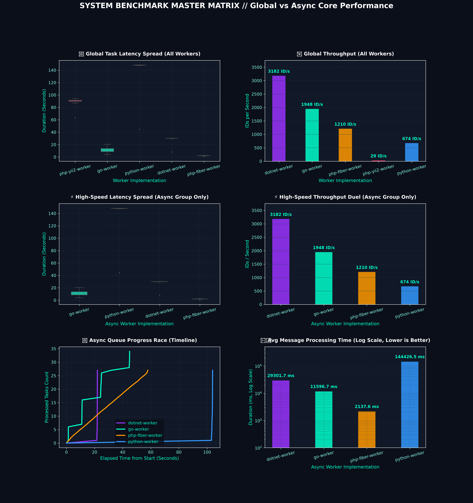

# ⚡ Distributed Email Campaign Benchmark Matrix (C# vs Go vs PHP Fiber vs Python vs PHP Sync)


---

## ⚠️ Disclaimer & Benchmark Flaws (Just for Fun!)

> This project was created solely to explore and contrast different approaches to asynchronous I/O processing in a local environment under specific conditions. No technology stack is being discredited.

### 🔍 Caveats & Known Limitations:
1. **Network Backpressure & SMTP Stalls**: Under heavy load, the mock SMTP server (MailHog) becomes the primary bottleneck. Storing thousands of active TCP connections in RAM leads to socket timeouts and distorts latency metrics.
2. **SMTP Connection Overhead**: Some workers send emails via separate TCP connections per recipient (simulating isolated `aiosmtplib` or `SendSingleEmailAsync` calls), creating significant OS network stack overhead due to repetitive TCP Handshakes.
3. **Single-threaded vs Multi-threaded**: Comparing single-threaded Event Loops (Python AsyncIO, PHP Revolt Fibers) against multi-threaded environments (.NET 8 ThreadPool, Go runtime scheduler) is inherently unequal, but it effectively demonstrates out-of-the-box runtime capabilities.

---

## 🎯 Project Overview & Concept

This repository provides a fully containerized performance benchmarking matrix designed to evaluate background message queue processing across multiple tech stacks. All workers pull message batches (containing **2,500 User IDs**) from **RabbitMQ**, query active email profiles from **MySQL**, dispatch emails to **MailHog**, and record precise execution telemetry into **MongoDB**.

### Implemented Workers:
- **C# (.NET 8 ThreadPool & Tasks)** — Multi-threaded parallel task execution utilizing non-blocking asynchronous sockets.
- **Go (Goroutines & Channels)** — High-efficiency concurrency powered by Go's native lightweight runtime scheduler.
- **PHP 8.3 Fiber (Revolt EventLoop & Amp v2)** — Modern non-blocking asynchronous PHP utilizing native Fibers.
- **Python 3 (AsyncIO / aio-pika / aiomysql)** — Standard event-driven asynchronous execution model.
- **PHP Yii2 (Synchronous Baseline)** — Traditional blocking sequential execution acting as a baseline reference.

---

## 📊 Performance Benchmark Master Matrix



---

## 📋 Comparative Performance Summary

| Metric | C# (.NET 8) | Go (Goroutines) | PHP 8.3 (Fiber) | Python (AsyncIO) | PHP Yii2 (Sync) |
| :--- | :---: | :---: | :---: | :---: | :---: |
| **Execution Paradigm** | Multi-threaded Async | Concurrent Goroutines | Single-threaded Fibers | Single-threaded Async | Synchronous Blocking |
| **Throughput (IDs / sec)** | **3182 ID/s** 🚀 | **1948 ID/s** ⚡ | **1210 ID/s** 🔥 | **674 ID/s** | **29 ID/s** |
| **Avg Task Latency** | ~29.3 s | ~11.5 s | **~2.1 s** ⏱️ | ~144.4 s | ~90.0 s |
| **Speedup vs Sync PHP** | **~110x faster** | **~67x faster** | **~42x faster** | **~23x faster** | Baseline (1x) |
| **Error Rate** | 0% | 0% | 0% | 0% | 0% |

---

## 🧠 Architectural Principles & Results Analysis

### 1. 🚀 C# .NET 8 (`3182 ID/s`)
- **Why highest Throughput:** .NET leverages a multi-threaded `ThreadPool`. Powered by `Task.Run`, batch processing executes concurrently across all available CPU cores.
- **Latency Behavior:** The `29.3 s` latency occurs because .NET opens hundreds of concurrent sockets to MailHog simultaneously. Sockets wait in OS-level queues during MailHog buffer saturation, but the overall total wall-clock time to clear the entire queue remains the fastest.

### 2. ⚡ Go (`1948 ID/s`)
- **Why consistent:** Lightweight Goroutines consume only kilobytes of memory and are managed by Go's efficient M:N scheduler.
- **Result:** Delivers a smooth, balanced queue progress timeline with zero memory spikes or thread starvation.

### 3. 🔥 PHP 8.3 Fiber / Revolt (`1210 ID/s`)
- **Why it outperformed Python and achieved lowest Latency (`2137 ms`):** Native Fibers combined with Revolt EventLoop switch execution context instantly during I/O waits (MySQL/Socket) without heavy runtime overhead.
- **Result:** Lowest single-message latency (**2.1 seconds**). Proves that asynchronous PHP 8.3 with Fibers is a formidable contender for I/O-bound workflows.

### 4. 🐍 Python AsyncIO (`674 ID/s`)
- **Why higher Latency (`144.4 s`):** Python's single-threaded event loop manages async tasks efficiently, but under MailHog saturation, `aiosmtplib` sockets spent considerable time blocked waiting for connection timeouts.

### 5. 🐌 PHP Yii2 Synchronous (`29 ID/s`)
- **Why baseline:** Standard synchronous process. Every step (`SELECT` query, individual `fsockopen` calls) blocks thread execution until the network/disk responds, eliminating concurrency.

---

## ⚙️ Step-by-Step Execution Methodology

1. **Infrastructure Provisioning**:
   ```bash
   make up
   ```

2. **Dependencies Initialization**:
   ```bash
   make composer-install
   ```

3. **Database Seeding & Task Enqueueing**:
   ```bash
   make seed
   make send
   ```

4. **Executing Workers**:
   ```bash
   # Run C# .NET worker
   make dotnet-worker-listen

   # Run Go worker
   make go-worker-listen

   # Run PHP Fiber worker
   make php-fiber-worker-listen

   # Run Python async worker
   make python-worker-listen

   # Run Synchronous PHP Yii2 worker
   make php-worker-listen
   ```

5. **Generate Analytics Dashboard**:
   ```bash
   make report
   ```

---

## 🛠️ Complete Makefile Reference

| Command | Description |
| :--- | :--- |
| `make up` | Start all Docker infrastructure containers |
| `make down` | Stop and tear down active containers |
| `make seed` | Seed MySQL database & enqueue benchmark tasks |
| `make dotnet-worker-listen` | Run C# .NET 8 high-throughput worker |
| `make go-worker-listen` | Run Go concurrent goroutine worker |
| `make php-fiber-worker-listen` | Run PHP 8.3 Revolt Fiber worker |
| `make python-worker-listen` | Run Python AsyncIO worker |
| `make php-worker-listen` | Run PHP Yii2 synchronous baseline worker |
| `make report` | Generate 3x2 master analytics dashboard |

---

## 📄 License

This project is open-source software licensed under the [MIT License](LICENSE).
