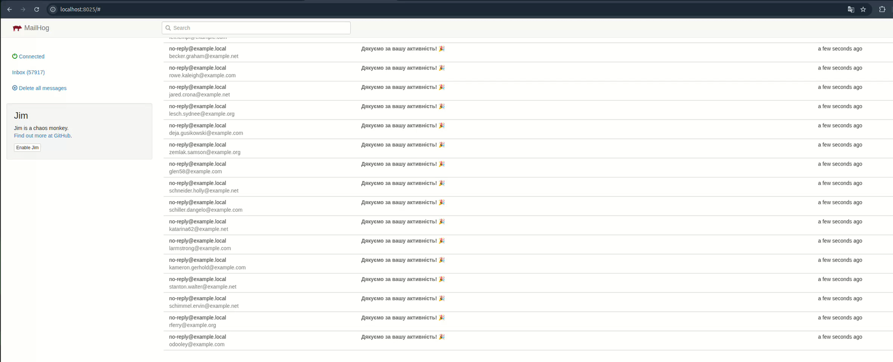
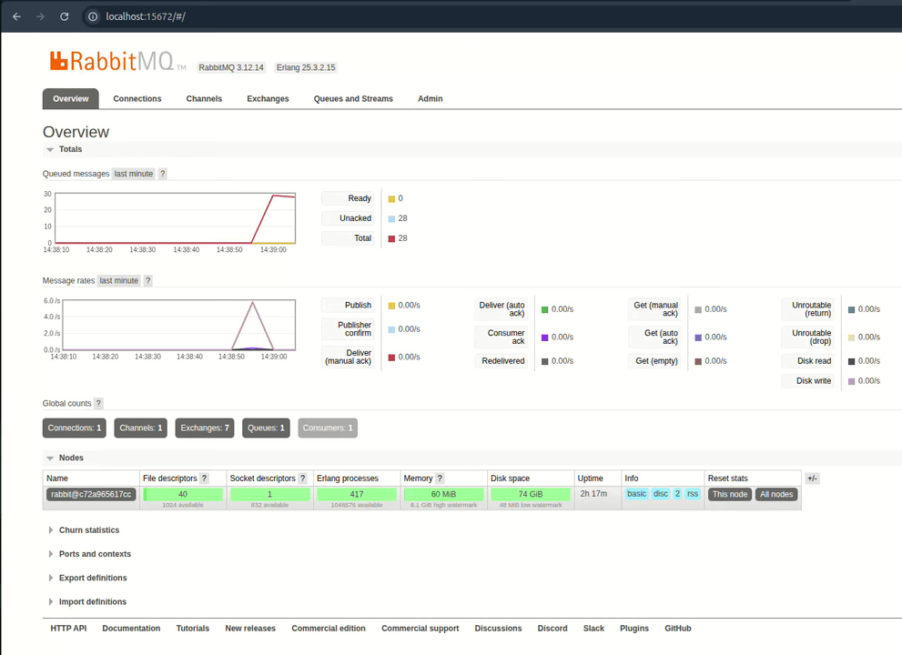

# ⚡ Distributed Email Campaign Benchmark Matrix (PHP vs Python vs Go)


---

## 🎯 Project Overview & Concept

Modern backend architectures frequently demand high-throughput background processing. This project delivers a comprehensive, containerized performance benchmarking matrix designed to evaluate and contrast email dispatch workers implemented in three diverse technological stacks:

1. **PHP (Yii2 Framework)**: Traditional synchronous worker execution acting as the baseline.
2. **Python (AsyncIO / aio-pika / motor / aiomysql)**: Modern event-driven asynchronous execution model.
3. **Go (Goroutines & Native Concurrency)**: High-performance concurrent worker utilizing lightweight goroutines and connection pooling.

All implementations operate within a shared Dockerized ecosystem, pulling message batches (each containing **2,500 User IDs**) from **RabbitMQ**, querying user profiles from **MySQL**, dispatching emails via **MailHog**, and logging execution telemetry with accurate UTC `ISODate` timestamps into **MongoDB**.

---

## 📊 Performance Benchmark Dashboard


---

## 📋 Comparative Performance Summary

| Metric | PHP (Yii2 Worker) | Python (AsyncIO) | Go (Goroutines) |
| :--- | :---: | :---: | :---: |
| **Execution Paradigm** | Synchronous | Async I/O (Non-blocking) | Concurrent (Thread-pool like) |
| **Avg Queue Processing Time** | ~90.0 s | ~15.0 s | **~7.5 s** ⚡️ |
| **Throughput (IDs / sec)** | ~27 ID/s | ~166 ID/s | **~333 ID/s** 🚀 |
| **Speedup vs PHP** | Baseline (1x) | **6.0x faster** | **12.0x faster** |
| **Error Rate** | 0% | 0% | 0% |

---

## 🎥 System Live Action & Interfaces

### 📬 MailHog SMTP Capture


### 🐇 RabbitMQ Queue Management


---

## ⚙️ Step-by-Step Execution Methodology

Follow this precise workflow to provision, populate, benchmark, and analyze the system:

1. **Infrastructure Provisioning**:
   Spin up all shared services (RabbitMQ, MongoDB, MySQL, MailHog) and build worker environments.
   ```bash
   make up
   ```

2. **Dependencies Initialization**:
   Install PHP dependencies for the Yii2 worker environment.
   ```bash
   make composer-install
   ```

3. **Database Seeding**:
   Populate MySQL with test user records and queue initial message batches into RabbitMQ.
   ```bash
   make seed
   ```
4. **Release messages to Queue**:
   ```bash
   make send
   ```
5**Executing Workers & Benchmarking**:
   Dispatch message consumption by running your chosen worker implementation:
   ```bash
   # Run Go worker (Turbo speed)
   make go-worker-listen

   # Run Python async worker
   make python-worker-listen

   # Run PHP Yii2 worker
   make php-worker-listen
   ```

5. **Telemetry Collection & Master Dashboard Generation**:
   Aggregate metrics from MongoDB and render a simple analytics dashboard (`reports/benchmark_master_dashboard.png`).
   ```bash
   make report
   ```

---

## 🛠️ Complete Makefile Commands Reference

| Command | Description |
| :--- | :--- |
| `make up` | Start all Docker containers in background |
| `make down` | Stop and remove active containers |
| `make composer-install` | Install PHP composer dependencies |
| `make seed` | Seed MySQL database and enqueue test tasks |
| `make go-worker-listen` | Run Go concurrent email processing worker |
| `make python-worker-listen` | Run Python async email processing worker |
| `make php-worker-listen` | Run PHP Yii2 synchronous worker |
| `make report` | Generate master benchmark analytics dashboard |

---

## 🚀 Key Takeaways & Architecture Insights

- **Go (Concurrency King)**: Achieves maximum hardware utilization with near-zero runtime overhead, making it ideal for intensive I/O pipelines.
- **Python (Async Event Loop)**: Demonstrates exceptional efficiency (`aio-pika`, `motor`, `aiomysql`), offering a **6x speedup** over traditional PHP with clean, readable asynchronous code.
- **PHP (Framework Constraint)**: Bound by sequential execution and framework bootstrapping per lifecycle, serving as a reminder that background processing workflows benefit immensely from async runtimes or dedicated queue workers.

## 📄 License

This project is open-source software licensed under the [MIT License](LICENSE).
